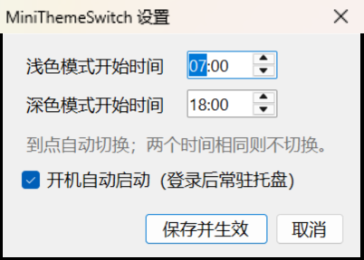

# MiniThemeSwitch

[](https://github.com/xf969038976/MiniThemeSwitch/releases/latest)

一个 **37 KB** 的 Windows 浅色/深色自动切换小工具：常驻托盘，按两个时间点切换系统主题，支持开机自启。

**[⬇ 下载最新版](https://github.com/xf969038976/MiniThemeSwitch/releases/latest)** —— 单个 exe，免安装，不需要 .NET SDK 或任何运行时。



## 为什么会有这个

[Auto Dark Mode](https://github.com/AutoDarkMode/Windows-Auto-Night-Mode) 很好用，但它的安装包 110 MB、装完占 426 MB，常驻内存约 100 MB——因为它把 .NET 运行时和 WinUI 3 整套框架都打包了进去，还带了 40 MB 的地图数据和 40 MB 的 ML 推理库。

这个工具只做一件事：到点把主题切了。核心代码 900 行，exe 37 KB，不打包任何运行时（直接用 Windows 自带的 .NET Framework 4.8）。

| | Auto Dark Mode | MiniThemeSwitch |
| --- | --- | --- |
| 安装包 | 110 MB | 37 KB（单文件，免安装） |
| 磁盘占用 | 426 MB | 37 KB |
| 常驻内存 | ~100 MB | ~29 MB |
| 空闲 CPU | <1% | 0 ms / 分钟（实测） |

## 用法

1. 把 `MiniThemeSwitch.exe` 放到一个固定目录（例如 `D:\Tools\MiniThemeSwitch\`），双击运行。
2. 首次运行会弹出设置窗口，之后只驻留系统托盘（不弹窗）。
3. **双击托盘图标**（或右键 → 设置时间…）修改时间，默认 `07:00` 切浅色、`18:00` 切深色。
4. 程序已在运行时再次双击 exe，会直接弹出设置窗口，不会开第二个实例。

右键菜单：

| 菜单项 | 作用 |
| --- | --- |
| 立即切换为浅色 / 深色 | 手动切一次，到下一个时间点自动恢复自动模式 |
| 暂停自动切换 | 临时停止自动切换（状态会保存） |
| 开机自动启动 | 勾选后写入 `HKCU\...\CurrentVersion\Run` |
| 设置时间… | 修改两个时间点 |
| 修复任务栏颜色（强制刷新） | 副屏任务栏没跟着变色时点一下 |
| 退出 | 退出程序（不再自动切换） |

> 关掉设置窗口**不会**退出程序（它回到托盘继续工作）；要真正退出请用右键菜单的「退出」，会先弹确认框。
>
> Windows 11 默认把新托盘图标收进 `^` 折叠区。如果看不到图标，点任务栏的 `^`，或到「设置 → 个性化 → 任务栏 → 其他系统托盘图标」里把它打开。

## 行为细节

- 切换的是「应用模式」+「系统模式」：`AppsUseLightTheme`、`SystemUsesLightTheme`，写完后向所有窗口广播 `WM_SETTINGCHANGE / ImmersiveColorSet`，任务栏、开始菜单、资源管理器立即跟变，不需要重启 explorer。
- 开机自启后立即校正一次：如果 07:00 时电脑关着，18:00 一开机就直接是深色，不会停在前一晚的状态。
- 支持跨午夜配置（比如浅色 18:00、深色 07:00）；两个时间相同则不自动切换。
- 定时器直接睡到下一个切换点（最长 1 小时醒一次），不轮询；睡眠唤醒 / 解锁时立即校正。
- 实测空闲开销：CPU 时间 0 ms / 分钟（<0.01% 单核），内存约 29 MB（其中大部分是 .NET 运行时的固定开销）。切换瞬间有几十毫秒的尖峰（广播 + 重绘任务栏）。

## 副屏任务栏不变色？

Windows 的副屏任务栏（`Shell_SecondaryTrayWnd`）经常不响应主题广播。本程序每次切换后会：广播 `WM_SETTINGCHANGE` + `WM_THEMECHANGED`，再逐个戳每块屏幕的任务栏窗口并强制重绘，0.7 秒后重复一遍。

如果还是卡着：右键菜单 →「修复任务栏颜色（强制刷新）」，或命令行 `MiniThemeSwitch.exe --fix`。它会瞬间翻转一次「透明效果」再恢复，逼 DWM 把所有任务栏重画一遍（约 220 ms，屏幕会闪一下）。

## 配置文件与卸载

- 配置：`%APPDATA%\MiniThemeSwitch\settings.ini`
- 日志：`%APPDATA%\MiniThemeSwitch\app.log`
- 卸载：托盘菜单 → 退出；删掉 exe 和 `%APPDATA%\MiniThemeSwitch`；再取消自启（菜单里取消勾选，或删除 `HKCU\Software\Microsoft\Windows\CurrentVersion\Run` 下的 `MiniThemeSwitch`）

## 编译

只有一个源文件 `Program.cs`，用 C# 5 语法（兼容 Windows 自带的编译器），**不需要安装 .NET SDK**。要求 Windows + .NET Framework 4.8（Win10 1903+ / Win11 自带）。

```bat
build.bat
```

`build.bat` 等价于：

```bat
C:\Windows\Microsoft.NET\Framework64\v4.0.30319\csc.exe /target:winexe /optimize+ /codepage:65001 ^
  /win32icon:app.ico ^
  /r:System.dll /r:System.Core.dll /r:System.Drawing.dll /r:System.Windows.Forms.dll ^
  /out:MiniThemeSwitch.exe Program.cs
```

编译产物默认输出到 `D:\Software\MiniThemeSwitch\`（可在 `build.bat` 里改 `DEST`）。

命令行模式（方便配合其它脚本、任务计划）：

```bat
MiniThemeSwitch.exe --light   :: 立即浅色
MiniThemeSwitch.exe --dark    :: 立即深色
MiniThemeSwitch.exe --auto    :: 按当前时间判断后切换
MiniThemeSwitch.exe --fix     :: 强制刷新任务栏颜色（副屏不变色时用）
```

## 已知限制

- 只切主题，不换壁纸、不换强调色、不换鼠标指针。
- 少数已打开的 UWP / 第三方程序不响应主题广播，需要重开才变色（Windows 自身行为）。
- 需要用户会话：靠托盘 + 登录自启，不装服务。
- 依赖 .NET Framework 4.8（Win10 1903 之后是系统组件，一般不需要额外安装）。

## 实现说明

- 主题切换：写两个 `HKCU` 注册表值 + `SendMessageTimeout(HWND_BROADCAST, WM_SETTINGCHANGE, "ImmersiveColorSet")`。
- 任务栏刷新：`EnumWindows` 找 `Shell_TrayWnd` / `Shell_SecondaryTrayWnd`，逐个发消息并 `RedrawWindow`；兜底方案是瞬时翻转 `EnableTransparency`。
- 自启：`HKCU\Software\Microsoft\Windows\CurrentVersion\Run`。
- 单实例：命名 `Mutex` + 命名事件；第二个实例通过事件唤醒已有实例并弹出设置窗口。
- 托盘、设置窗口：WinForms（`NotifyIcon` + `TableLayoutPanel` 自动布局，支持高 DPI）。
